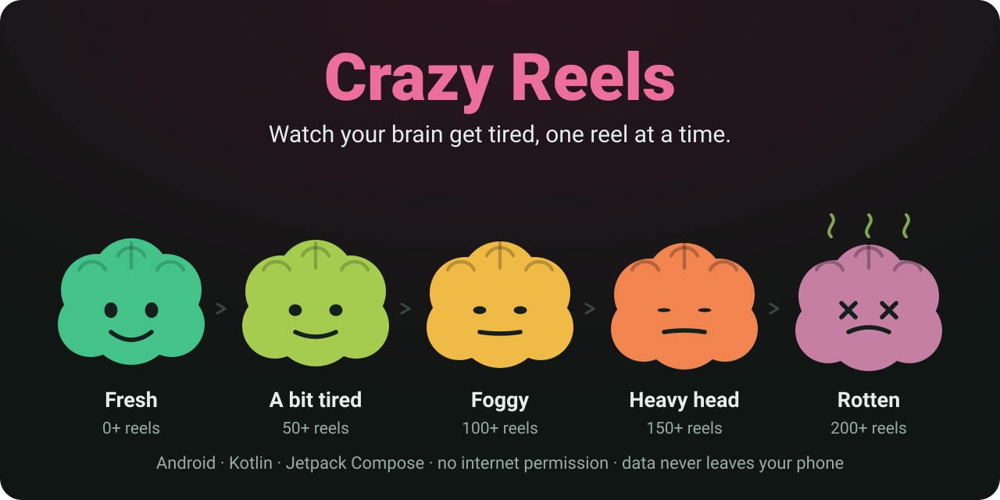

<p align="center">
  
</p>

<p align="center">
  <a href="https://github.com/jahid-dev-analytics/crazy-reels/releases/latest"></a>
  
  
  
  <a href="LICENSE"></a>
</p>

<h3 align="center">You said "just one more reel" 214 reels ago.</h3>

<p align="center">
Crazy Reels counts every reel and short you scroll and shows it as a little brain<br>
that goes from <b>fresh</b> to <b>rotten</b> as the number climbs. No guilt-trip lectures, no account,<br>
no cloud. Just an honest number that floats on top of the feed while you scroll.
</p>

---

## Why

Screen-time apps tell you "2 h 41 m in Instagram". That number is easy to ignore.
"**187 reels**" is not. Counting the actual swipes turns an invisible habit into something you can see, and the brain makes it a bit funny instead of preachy.

## Features

- 🧠 **A brain that reacts.** Five stages, each with its own colour, eyes, mouth and a one-line nudge. It sags, its eyes droop, and at 200 it starts to stink.
- 🔴 **Live counter while you scroll.** A small bubble sits on top of the reels feed and ticks up with every swipe. Drag it anywhere; it remembers where you left it. Turn it off any time.
- 🔁 **Counts fairly.** Swiping back up to rewatch, or the double event Android sends on every swipe, does not add to the count. Only reels you have not seen yet in that run count.
- 📅 **Resets every day** at midnight, per app.
- 🇧🇩 **English and Bangla** built in.
- 🔒 **Private by design.** The app asks for **zero** Android permissions. It has no internet access at all, so your counts physically cannot leave the phone.

## The five brains

| Reels today | Brain | What it tells you |
|---:|---|---|
| 0+ | **Fresh** | Sharp and awake. Keep it this way. |
| 50+ | **A bit tired** | Your brain has started to yawn. |
| 100+ | **Foggy** | Hard to focus now. Good time to stop. |
| 150+ | **Heavy head** | This is where hours disappear. |
| 200+ | **Rotten** | 200+ reels. Your brain needs a walk. |

## Supported apps

| App | Status |
|---|---|
| Instagram Reels | ✅ Counting (tested on Instagram 452, Reels tab and reels opened from feed or profile) |
| YouTube Shorts | 🛠️ Listening, detector wanted |
| TikTok | 🛠️ Listening, detector wanted |
| Facebook / Facebook Lite Reels | 🛠️ Listening, detector wanted |
| Snapchat Spotlight | 🛠️ Listening, detector wanted |

Each app lays out its reels screen differently, so each one needs its own small detector. Adding one is a great first contribution, see [Add a new app](#add-a-new-app).

## Install

1. Download `crazy-reels-v0.1.0.apk` from the [latest release](https://github.com/jahid-dev-analytics/crazy-reels/releases/latest) on your phone.
2. Open it and allow "Install unknown apps" for your browser or file manager when Android asks.
3. Open **Crazy Reels** and tap **Open settings**.
4. In Accessibility, open **Crazy Reels counter** and switch it on.
5. Go scroll some reels and watch the bubble.

> On Android 13+ a side-loaded app's Accessibility switch can be greyed out. Open **Settings → Apps → Crazy Reels → ⋮ → Allow restricted settings**, then try step 4 again.

## How it works

```
Instagram / YouTube / TikTok ...  ──scroll events──▶  ReelCounterService (AccessibilityService)
                                                          │
                                         ReelDetector for that app decides "new reel?"
                                                          │
                                ReelStore (today's count per app) ──▶ Brain + live CounterBubble
```

- `ReelCounterService` is an Android Accessibility Service that **only** listens to the six package names above. Other apps are never read.
- A `ReelDetector` watches the reels pager's scroll events. It remembers the furthest page reached and counts only when you go further, so rewatches are free.
- `ReelStore` keeps today's count per app on the device, and the home screen and the floating bubble both read from it.
- The brain is drawn in code with Compose `Canvas`, so it scales to any size and morphs smoothly between stages.

```
android/app/src/main/java/com/flyingman/crazyreels/
├── counting/   ReelCounterService, ReelDetector, ReelStore, ReelApp
├── core/       BrainState (the 5 stages), AppSettings
├── ui/brain/   the brain drawing
├── ui/overlay/ floating live counter
├── ui/home/    home screen
└── debug/      LayoutRecorder (records an app's screen layout to build new detectors)
```

## Build from source

Needs JDK 17+ and the Android SDK (Android Studio installs both).

```bash
git clone https://github.com/jahid-dev-analytics/crazy-reels.git
cd crazy-reels/android
./gradlew assembleDebug
adb install -r app/build/outputs/apk/debug/app-debug.apk
```

Or open the `android` folder in Android Studio and press Run.

## Add a new app

1. Install a **debug** build. The home screen then shows a **Developer** section.
2. Turn on **Record screen layout**, open the target app (say YouTube Shorts) and swipe through a few shorts.
3. The recorder writes the scroll events and screen layouts it sees to a JSON-lines file in the app's private storage (nothing is uploaded). Pull it over USB:
   ```bash
   adb exec-out run-as com.flyingman.crazyreels cat files/recordings/com.google.android.youtube.jsonl > youtube.jsonl
   ```
   Then find the view that pages between shorts.
4. If the app uses a pager that reports its page index, you are almost done: add one entry to `ReelDetectors` in `ReelDetector.kt` with its view id and class name, exactly like the Instagram one.
5. If it does not, write a new class that implements `ReelDetector`.
6. Open a pull request and say which app version you tested on.

## Roadmap

- [x] Brain with five stages
- [x] Instagram Reels counting
- [x] Floating live counter
- [ ] YouTube Shorts, TikTok, Facebook and Snapchat detectors
- [ ] Daily limit with a gentle "time for a walk" nudge
- [ ] History and weekly chart
- [ ] Home-screen widget
- [ ] Optional web dashboard and a Chrome extension for laptops

## Contributing

Issues and pull requests are welcome, especially new app detectors. If something counts wrong, open an issue with your phone model, Android version and the app version.

## Support the project

If Crazy Reels made you put the phone down even once, **give it a ⭐**. It helps other people find it.

## License

[MIT](LICENSE) © 2026 Jahidul Islam
